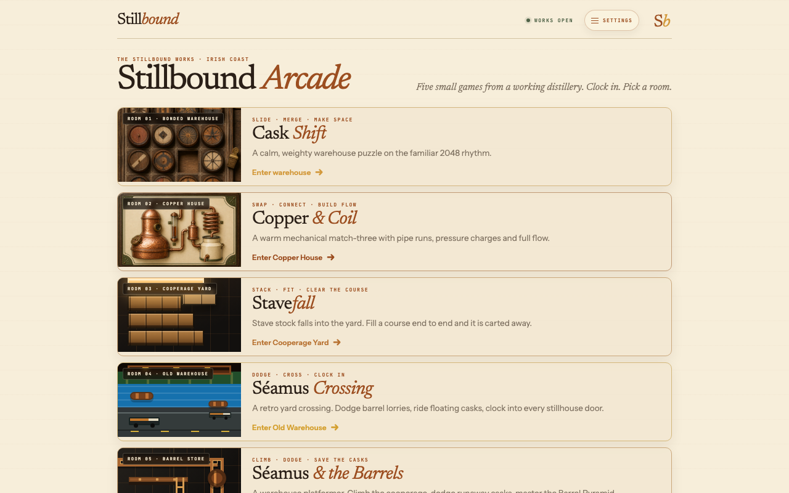

# Stillbound Arcade

**Five small browser games that teach how whiskey is made. Play one in a minute. A distiller will recognise every object on screen.**

## Why I built it

Most people will never read a paper on cask maturation, but they will play a game for a minute. Distilling is already full of game mechanics: casks stacked in bays, staves fitted into a barrel, barrels rolled across a yard. The Arcade keeps the rules familiar and the world true to the process, so curiosity leads back to Stillbound's research. It is also where I try new techniques, at a size where a failed experiment costs an evening.

## What's under the hood

- **Five rooms, five genres.** A merge puzzle, match-three, falling staves, a crossing game and a platformer.
- **Game rules kept apart from the graphics,** and tested, so the look can change without breaking the maths.
- **Works offline and installs like an app.** No accounts, no ads, no tracking.
- **Four more games were built and cut** because they didn't earn their place.

## Where it stands

Live at [stillbound-arcade.vercel.app](https://stillbound-arcade.vercel.app). Source: private.

---

Built by John Robinson · [Stillbound.ai](https://stillbound.ai)
